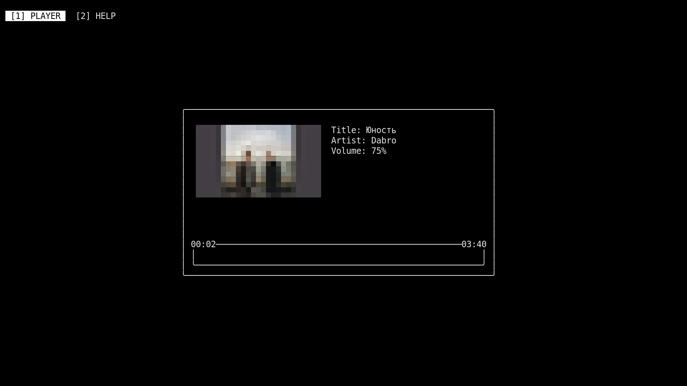

# ZaitC

ZaitC is a minimal TUI music player for MPD, written in C and built with notcurses.

## Preview



## Installation

### Requirements

* `GCC` or another compatible C compiler
* `pkg-config`
* [notcurses](https://notcurses.com)
* [libmpdclient](https://musicpd.org/libs/libmpdclient)
* [MPD](https://www.musicpd.org/)

### Build from source

```bash
git clone https://codeberg.org/xdesai/zaitc.git
cd zaitc
sudo make install
```

### Run with nix

```bash
nix run git+https://codeberg.org/xdesai/zaitc.git
```

## Usage

### Keybindings

| Key   | Action        |
| ----- | ------------- |
| `p`   | Play / pause  |
| `s`   | Stop          |
| `n`   | Next song     |
| `N`   | Previous song |
| `f`   | Seek forward  |
| `b`   | Seek backward |
| `k`   | Volume up     |
| `j`   | Volume down   |
| `r`   | Toggle repeat |
| `Tab` | Next Tab      |

### Configuration

Configuration support is currently limited.

For now, settings can be changed in `src/zait.c` before building.
A proper configuration system is planned.

## TODO

- [ ] Add command-line options (e.g. `--host` `--port`)
- [ ] Figure out the configuration/settings implementation
- [ ] Add `library` tab
- [ ] Add `queue` tab
- [ ] Finish `help` tab
